# PC Deal Tracker 🖥️

A Python project that checks Australian prices for the parts in my next gaming
PC **twice a day** (7:37am and 7:37pm Brisbane time), using GitHub Actions. It looks at:

- **[StaticICE](https://www.staticice.com.au)** - a price-comparison site covering ~15 stores
  (PC Case Gear, Scorptec, Umart, MSY, JB Hi-Fi, Computer & Parts Land, JW Computers,
  CCPU, Computer Alliance, PLE, I-Tech, MegaBuy...)
- **[Mwave](https://www.mwave.com.au)** - checked directly, since it isn't on StaticICE
- **[OzBargain](https://www.ozbargain.com.au)** - community-posted deals from the last 30 days

✅ = at or below my target price · 🟢 in stock · 🟡 pre-order · 🔴 out of stock · ⚪ store doesn't say

## Today's prices

<!-- PRICES:START -->
_Last checked: 2026-10-30 08:16 (Brisbane time) · Sources: StaticICE (~15 stores), Mwave, OzBargain_

### Summary

| | Part | Best price | Target | Deal? | Store |
|---|---|---:|---:|:---:|---|
|  | [RX 9070 XT](#rx-9070-xt) | **$1,199** | $1,099 | — | PC Case Gear |
|  | [RTX 5070 Ti](#rtx-5070-ti) | **$1,899** | $1,199 | — | Mwave |
|  | [RTX 5080](#rtx-5080) | **$2,664** | $1,799 | — | I-Tech |
|  | [RTX 5090](#rtx-5090) | **$10,499** | $4,200 | — | PC Case Gear |
|  | [Ryzen 7 9800X3D](#ryzen-7-9800x3d) | **$595** | $549 | — | CCPU Computers |
|  | [Ryzen 7 9850X3D](#ryzen-7-9850x3d) | **$740** | $699 | — | CCPU Computers |
|  | [Ryzen 9 9950X3D](#ryzen-9-9950x3d) | **$835** | $899 | ✅ | CCPU Computers |
|  | [DDR5 32GB (2x16GB) 6000MHz CL30](#ddr5-32gb-2x16gb-6000mhz-cl30) | **$359** | $349 | — | Computer & Parts Land |
|  | [DDR5 64GB (2x32GB) 6000MHz CL30](#ddr5-64gb-2x32gb-6000mhz-cl30) | **$959** | $899 | — | Computer & Parts Land |
|  | [2TB NVMe SSD](#2tb-nvme-ssd) | **$226.70** | $219 | — | Computer & Parts Land |
|  | [4TB NVMe SSD](#4tb-nvme-ssd) | **$449** | $429 | — | Computer & Parts Land |
|  | [8TB NVMe SSD](#8tb-nvme-ssd) | **$1,599** | $1,199 | — | Scorptec |

## Graphics cards

### RX 9070 XT
Target: **$1,099**

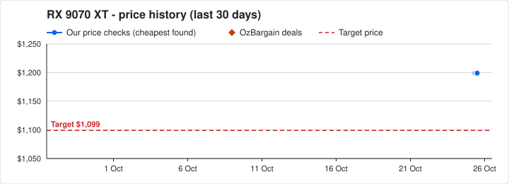

| | Price | Store | Product | Stock |
|---|---:|---|---|---|
| 🎮 | **$1,199** | PC Case Gear | 1. [PowerColor Radeon RX 9070 XT Reaper 16GB [RX9070XT-16G-A]](https://www.pccasegear.com/products/68061/powercolor-radeon-rx-9070-xt-reaper-16gb) | ⚪ check site |
| 🎮 | **$1,240** | CCPU Computers | 2. [XFX Swift RX 9070XT 16GB Triple Fan Gaming RX-97TSWF3B9](https://www.ccpu.com.au/product/xfx-swift-rx-9070xt-16gb-triple-fan-gaming-rx-97tswf3b9/)<br><sub>Also: [$1,249 Scorptec](https://www.scorptec.com.au/product/graphics-cards/amd/117063-rx-97tswf3b9) · [$1,299 PC Case Gear](https://www.pccasegear.com/products/70449/xfx-radeon-rx-9070-xt-swift-triple-fan-16gb-black)</sub> | ⚪ check site |
| 🎮 | **$1,240** | CCPU Computers | 3. [Gigabyte GV-R907XGAMINGOCICE-16GD Radeon RX 9070 XT GAMING OC ICE 16GB](https://www.ccpu.com.au/product/gigabyte-gv-r907xgamingocice-16gd-radeon-rx-9070-xt-gaming-oc-ice-16gb/)<br><sub>Also: [$1,299 Scorptec](https://www.scorptec.com.au/product/graphics-cards/amd/122663-gv-r907xgamingocice-16gd)</sub> | ⚪ check site |
| 🎮 | **$1,240** | CCPU Computers | 4. [Sapphire Pure Redeon RX 9070 XT Gaming OC 16GB 11348-02-20G White](https://www.ccpu.com.au/product/sapphire-pure-redeon-rx-9070-xt-gaming-oc-16gb-11348-02-20g-white/)<br><sub>Also: [$1,299 Computer Alliance](https://www.computeralliance.com.au/product/sapphire-rx-9070-xt-pure-16gb-white-graphics-card/)</sub> | ⚪ check site |
| 🎮 | **$1,240** | CCPU Computers | 5. [ASUS PRIME-RX9070XT-O16G Radeon RX 9070 XT PRIME 16GB OC](https://www.ccpu.com.au/product/asus-prime-rx9070xt-o16g-radeon-rx-9070-xt-prime-16gb-oc/) | ⚪ check site |

<details>
<summary>OzBargain deal history, last 12 months (46)</summary>

- 18 Sep · $999 · Centre Com · [Sapphire Pulse Radeon RX 9070 XT 16GB GDDR6 Graphics Card $999 Delivered ($0 VIC, QLD, NSW C&C/ in-…](https://www.ozbargain.com.au/node/975577) (expired)
- 18 Jul · $929 · Mwave · [Sapphire Radeon RX 9070 XT PURE 16GB Video Card $929 Delivered / NSW C&C @ Mwave](https://www.ozbargain.com.au/node/968322) (expired)
- 07 Jul · $869 · KS Computer Amazon AU · [[Prime] XFX Mercury AMD Radeon RX 9070XT OC Magnetic Air Edition GPU $869 Delivered @ KS Computer A…](https://www.ozbargain.com.au/node/966535) (expired)
- 29 Jun · $854.05 · Mwave · [Gigabyte Radeon RX 9070 XT GAMING OC 16GB GDDR6 Video Card $854.05 Delivered ($0 NSW C&C) @ Mwave](https://www.ozbargain.com.au/node/965531) (expired)
- 20 Jun · $900 · Mwave · [XFX Mercury Radeon RX9070 XT OC Gaming Edition 16GB GDDR6 Video Card $900 + Delivery ($0 to Metro/ …](https://www.ozbargain.com.au/node/964343) (expired)
- 01 Jun · $809.10 · Computer Alliance eBay · [XFX RX 9070 XT Swift Triple Fan 16GB GDDR6 Graphics Card $809.10 Delivered @ Computer Alliance eBay](https://www.ozbargain.com.au/node/961459) (expired)
- 25 May · $854.05 · Mwave · [AMD Radeon RX 9070 XT 16GB GDDR6 GPU: XFX Swift Triple Fan Gaming Edition $854.05, Sapphire Pulse $…](https://www.ozbargain.com.au/node/960519) (expired)
- 25 Apr · $845 · Shopping Express · [XFX Swift Radeon RX 9070 XT Triple Fan Gaming Edition Graphics Card $845 + Shipping @ Shopping Expr…](https://www.ozbargain.com.au/node/956878) (expired)
- 31 Mar · $998 · All Needs Computers · [XFX Mercury AMD Radeon RX 9070 XT OC Magnetic Air Edition RGB 16GB GDDR6 Black $998 + Delivery ($0 …](https://www.ozbargain.com.au/node/953978) (expired)
- 29 Mar · $899 · Computer Alliance · [Gigabyte Radeon RX 9070 XT Gaming OC 16GB GPU $899 + Delivery @ Computer Alliance](https://www.ozbargain.com.au/node/953793) (expired)
- 28 Mar · $999 · Umart · [Sapphire Radeon RX 9070 XT Pure Gaming 16GB OC Graphics Card $999 + Delivery ($0 C&C / in-Store) @ …](https://www.ozbargain.com.au/node/953723) (expired)
- 20 Mar · $839 · Mwave · [Sapphire RX 9070 XT Pulse Gaming 16GB OC $839 + Del (Exp), XFX RX 9070 XT Swift Triple Fan Gaming E…](https://www.ozbargain.com.au/node/952783) (expired)
- 19 Mar · $829.60 · Centre Com eBay · [[Afterpay] PowerColor Radeon Reaper RX 9070 XT 16GB GDDR6 Graphics Card $829.60 Delivered @ Centre …](https://www.ozbargain.com.au/node/952499) (expired)
- 15 Mar · $899 · Umart · [Gigabyte Radeon RX 9070 XT Gaming OC Ice 16GB Graphics Card $899 + Delivery ($0 C&C) @ Umart](https://www.ozbargain.com.au/node/951788) (expired)
- 14 Mar · $869 · Mwave · [XFX AMD Radeon RX 9070 XT Swift Triple Fan Gaming Edition 16GB GDDR6 GPU $869 Delivered @ Mwave](https://www.ozbargain.com.au/node/951718) (expired)
- 11 Mar · $877.50 · Smart Home Store eBay · [Gigabyte Radeon RX 9070 XT GAMING OC 16GB GPU $877.50 Delivered @ Smart Home Store eBay](https://www.ozbargain.com.au/node/951337) (expired)
- 05 Mar · $879 · Centre Com · [PowerColor Radeon Reaper RX 9070 XT 16GB GDDR6 Graphics Card $879 Delivered ($874 Elite Club Signup…](https://www.ozbargain.com.au/node/950501) (expired)
- 04 Mar · $899 · Centre Com · [XFX Swift AMD Radeon RX 9070 XT Triple Fan Gaming Edition 16GB GPU $899 Delivered / VIC/NSW/QLD/SA …](https://www.ozbargain.com.au/node/950323) (expired)
- 04 Mar · $901.55 · PC Case Gear · [5% off Graphics Cards (e.g. PowerColor 9070 XT Reaper $901.55 delivered) @ PC Case Gear](https://www.ozbargain.com.au/node/950408) (expired)
- 04 Mar · $899 · Mwave · [XFX AMD Radeon RX 9070 XT Swift Triple Fan Gaming Edition 16GB GDDR6 GPU $899 Delivered @ Mwave](https://www.ozbargain.com.au/node/950412) (expired)
- 04 Mar · $889 · Umart · [Sapphire Radeon RX 9070 XT Pulse Gaming 16GB OC Graphics Card $889 + Delivery ($0 C&C) @ Umart](https://www.ozbargain.com.au/node/950419) (expired)
- 28 Feb · $901.55 · PC Case Gear · [5% off Graphics Cards (e.g. PowerColor 9070 XT Reaper $901.55 Delivered / VIC C&C) @ PC Case Gear](https://www.ozbargain.com.au/node/949801) (expired)
- 27 Feb · $949 · Centre Com · [Powercolor Hellhound AMD Radeon RX 9070 XT 16GB GDDR6 GPU $949 Delivered / C&C / in-Store @ Centre …](https://www.ozbargain.com.au/node/949745) (expired)
- 26 Feb · $934.15 · Good Games Pavilion eBay · [XFX Swift AMD Radeon RX 9070 XT 16GB GDDR6 Graphics Card $934.15 ($912.17 eBay Plus) Delivered @ Go…](https://www.ozbargain.com.au/node/949662) (expired)
- 21 Feb · $949 · Centre Com · [PowerColor Radeon Reaper RX 9070 XT 16GB Graphics Card $949 Delivered / C&C / in-Store @ Centre Com](https://www.ozbargain.com.au/node/949063) (expired)
- 20 Feb · $959 · PC Case Gear · [ASRock Radeon RX 9070 XT Challenger 16GB GDDR6 Graphics Card $959 Delivered / VIC C&C / in-Store @ …](https://www.ozbargain.com.au/node/948949) (expired)
- 20 Feb · $949 · PC Case Gear · [PowerColor Radeon RX 9070 XT Reaper 16GB Graphics Card $949 Delivered / VIC C&C / in-Store @ PC Cas…](https://www.ozbargain.com.au/node/948983) (expired)
- 02 Feb · $944 · Centre Com · [PowerColor Radeon Reaper RX 9070 XT GPU $944 Delivered ($0 C&C/ in-Store) @ Centre Com](https://www.ozbargain.com.au/node/946534) (expired)
- 01 Jan · $989 · Centre Com · [Powercolor Hellhound AMD Radeon RX 9070 XT 16GB GDDR6 GPU $989 Delivered ($0 C&C/ in-Store) @ Centr…](https://www.ozbargain.com.au/node/942740) (expired)
- 08 Dec · $959 · Centre Com · [PowerColor Radeon RX 9070 XT Reaper 16GB Graphics Card $959 Delivered ($0 NSW, QLD, SA, VIC C&C/ in…](https://www.ozbargain.com.au/node/939055) (expired)
- 03 Dec · $974.22 · SmartHomestore eBay · [[eBay Plus] Asus Prime RX 9070 XT OC 16GB GPU $974.22 (+ $100 E-Gift + US$20 Steam GC via Asus) Del…](https://www.ozbargain.com.au/node/938249) (expired)
- 01 Dec · $1,029 · Centre Com · [Asus Prime Radeon RX 9070 XT 16GB OC Graphics Card $1029 Delivered (+ $100 E-Gift + US$20 Steam GC …](https://www.ozbargain.com.au/node/937798) (expired)
- 28 Nov · $989 · Mwave · [XFX AMD Radeon RX 9070XT Swift Triple Fan Gaming Edition 16GB GDDR6 Video Card $989 + Delivery ($0 …](https://www.ozbargain.com.au/node/937079) (expired)
- 28 Nov · $969 · Centre Com · [ASRock Radeon Steel Legend RX 9070 XT 16G DDR6 Graphics Card $969 Delivered ($0 NSW, QLD, SA, VIC C…](https://www.ozbargain.com.au/node/937181) (expired)
- 25 Nov · $1,099 · Centre Com · [Sapphire Nitro + RX Radeon 9070 XT 16GB OC Video Card $1099 Delivered / $0 C&C @ Centre Com](https://www.ozbargain.com.au/node/936013) (expired)
- 25 Nov · $989 · Centre Com · [XFX Swift AMD Radeon RX 9070 XT Triple Fan Gaming Edition Graphics Card $989 Delivered ($0 SA, VIC …](https://www.ozbargain.com.au/node/936109) (expired)
- 24 Nov · $949 · KS Computer via Amazon AU · [XFX Swift AMD Radeon RX 9070XT Triple Fan White, 16GB GDDR6 $949 Shipped @ KS Computer via Amazon AU](https://www.ozbargain.com.au/node/935644) (expired)
- 22 Nov · $999 · PLE · [Gigabyte Radeon RX 9070 XT Gaming OC 16GB Graphics Card $999 + Delivery ($0 WA C&C) @ PLE](https://www.ozbargain.com.au/node/935260) (expired)
- 21 Nov · $999 · Centre Com · [PowerColor Radeon Hellhound RX 9070 XT 16GB Graphics Card $999.00 Delivered ($0 NSW, QLD, SA, VIC C…](https://www.ozbargain.com.au/node/934942) (expired)
- 21 Nov · $999 · Centre Com · [PowerColor Radeon RX 9070 XT Reaper 16GB Graphics Card $999 Delivered ($0 NSW, QLD, SA, VIC C&C/ in…](https://www.ozbargain.com.au/node/934946) (expired)
- 20 Nov · $943.02 · shopping-express-clearance eBay · [XFX Radeon Swift RX 9070 XT 16GB Graphics Card $943.02 ($967.20 eBay Plus) Delivered @ shopping-exp…](https://www.ozbargain.com.au/node/934695) (expired)
- 13 Nov · $944 · Allneeds Computers · [XFX Swift AMD Radeon RX 9070 XT 16GB GDDR6 Graphics Card $944 Delivered @ Allneeds Computers](https://www.ozbargain.com.au/node/933037) (expired)
- 12 Nov · $1,099 · KS Computer via Amazon AU · [XFX Mercury AMD Radeon RX 9070 XT OC Graphics Card $1,099 Delivered @ KS Computer via Amazon AU](https://www.ozbargain.com.au/node/932821) (expired)
- 10 Nov · $989 · Centre Com · [XFX Swift AMD Radeon RX 9070 XT 16GB Graphics Card $989 Delivered ($0 VIC, QLD, NSW C&C/ VIC In-Sto…](https://www.ozbargain.com.au/node/932263) (expired)
- 10 Nov · $959.20 · Futu_Online eBay · [XFX Radeon Swift RX 9070 XT 16GB Graphics Card $959.20 Delivered @ Futu_Online eBay](https://www.ozbargain.com.au/node/932354) (expired)
- 03 Nov · $909.50 · CORESWITCH via eBay · [[Zip] Asus Prime Radeon RX 9070 XT 16G OC Edition GDDR6 Graphics Card $909.50 Delivered @ CORESWITC…](https://www.ozbargain.com.au/node/931331) (expired)

</details>

### RTX 5070 Ti
Target: **$1,199**

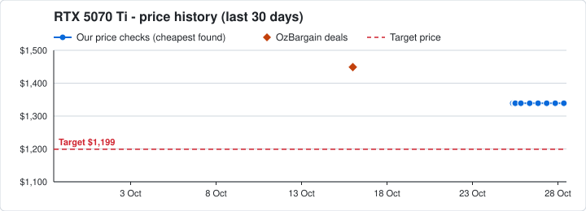

| | Price | Store | Product | Stock |
|---|---:|---|---|---|
|  | **$1,899** | Mwave | 1. [Inno3D GeForce RTX 5070 TI X3 OC 16GB GDDR7 Video Card](https://www.mwave.com.au/products/inno3d-geforce-rtx-5070-ti-x3-oc-16gb-gddr7-video-card-ac83002) | 🟢 in stock |
|  | **$1,899** | Mwave | 2. [Palit GeForce RTX 5070 Ti GamingPro-S 16GB Video Card](https://www.mwave.com.au/products/palit-geforce-rtx-5070-ti-gamingpros-16gb-video-card-ac88912) | 🟢 in stock |
|  | **$1,899** | Mwave | 3. [ASUS PRIME GeForce RTX 5070 Ti 16GB GDDR7 OC Edition Video Card](https://www.mwave.com.au/products/asus-prime-geforce-rtx-5070-ti-16gb-gddr7-oc-edition-video-card-ac81834) | 🟢 in stock |
|  | **$1,999** | Mwave | 4. [Gigabyte GeForce RTX 5070 Ti AERO OC 16GB Video Card](https://www.mwave.com.au/products/gigabyte-geforce-rtx-5070-ti-aero-oc-16gb-video-card-ac82642) | 🟢 in stock |
|  | **$1,999** | Mwave | 5. [Gigabyte GeForce RTX 5070 Ti EAGLE OC 16GB Video Card](https://www.mwave.com.au/products/gigabyte-geforce-rtx-5070-ti-eagle-oc-16gb-video-card-ac82612) | 🟢 in stock |

<details>
<summary>OzBargain deal history, last 12 months (11)</summary>

- 16 Oct · $1,449 · Umart · [PNY GeForce RTX 5070 Ti ARGB Triple Fan Plus OC 16G Graphics Card $1,449 + Delivery ($0 C&C) @ Umart](https://www.ozbargain.com.au/node/979226) (expired)
- 11 Jun · $1,149 · Shopping Express · [MSI GeForce RTX 5070 Ti 16G Shadow 3X OC 16GB GDDR7 Graphics Card $1,149 Delivered @ Shopping Expre…](https://www.ozbargain.com.au/node/963007) (expired)
- 24 May · $1,269 · Umart / MSY · [MAXSUN iCraft GeForce RTX 5070 Ti OC 16GB Graphics Card $1269 + Delivery ($0 C&C) @ Umart / MSY](https://www.ozbargain.com.au/node/960410) (expired)
- 02 Feb · $1,262 · Centre Com · [Zotac Gaming GeForce RTX 5070 Ti Solid SFF OC GPU $1262 Delivered ($0 C&C/ in-Store) @ Centre Com](https://www.ozbargain.com.au/node/946535) (expired)
- 09 Dec · $1,379 · Computer Alliance · [ASUS Prime RTX 5070 Ti 16GB Graphics Card $1379 Delivered (+Bonus $100 eGift Card via Redemption) @…](https://www.ozbargain.com.au/node/939170) (expired)
- 03 Dec · $1,231 · Centre Com eBay · [[eBay Plus] PNY GeForce RTX 5070 Ti 16GB GDDR7 Triple Fans Graphics Card $1231 Delivered @ Centre C…](https://www.ozbargain.com.au/node/938144) (expired)
- 28 Nov · $1,169 · Scorptec · [MSI GeForce RTX 5070 Ti 16G VENTUS 3X OC Graphics Card $1169 + Delivery ($0 to Metro/ C&C/ In-Store…](https://www.ozbargain.com.au/node/936956) (expired)
- 19 Nov · $1,199 · Centre Com · [PNY GeForce RTX 5070 Ti 16GB GDDR7 Triple Fans Graphics Card $1199 Delivered ($0 C&C/ in-Store) @ C…](https://www.ozbargain.com.au/node/934290) (expired)
- 19 Nov · $1,148 · Futu_Online eBay · [Palit GeForce RTX 5070 Ti GamingPro V1 16GB Graphics Card $1148 Delivered (Excl. NT) @ Futu_Online …](https://www.ozbargain.com.au/node/934331) (expired)
- 03 Nov · $1,299 · Centre Com · [Zotac Gaming GeForce RTX 5070 Ti Solid SFF OC Graphics Card $1299 Delivered ($0 VIC, QLD, NSW C&C/ …](https://www.ozbargain.com.au/node/931230) (expired)
- 03 Nov · $1,199.35 · Centre Com eBay · [[Zip] Galax GeForce RTX 5070 Ti EX Gamer 1-Click OC Graphics Card $1,199.35 + $5 Delivery @ Centre …](https://www.ozbargain.com.au/node/931260) (expired)

</details>

### RTX 5080
Target: **$1,799**

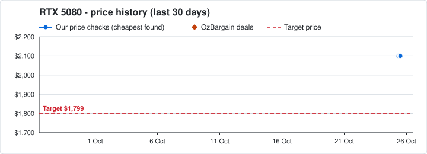

| | Price | Store | Product | Stock |
|---|---:|---|---|---|
| 🎮 | **$2,664** | I-Tech | 1. [INNO3D NVidia GeForce RTX 5080 X3 16GB GDDR7 2617 MHz Boost Clock, RA…](http://www.clixGalore.com/PSale.aspx?BID=14785&AfID=100703&AdID=1632&AffDirectURL=https://www.i-tech.com.au/n50803-16d7-176068n-inno3d-nvidia-geforce-rtx-5080-x3-16-430969.html) | ⚪ check site |
| 🎮 | **$2,680** | CCPU Computers | 2. [Palit NE75080019T2-GB2035S RTX 5080 Infinity 3 16GB](https://www.ccpu.com.au/product/palit-ne75080019t2-gb2035s-rtx-5080-infinity-3-16gb-ne75080019t2-35/)<br><sub>Also: [$2,699 Scorptec](https://www.scorptec.com.au/product/graphics-cards/nvidia/126954-ne75080019t2-gb2035s) · [$2,899 PC Case Gear](https://www.pccasegear.com/products/73434/palit-geforce-rtx-5080-infinity-3-gddr7-16gb)</sub> | ⚪ check site |
| 🎮 | **$2,680** | CCPU Computers | 3. [PALIT NE75080S19T2-GB2031A GeForce RTX 5080 GamingPro OC 16GB](https://www.ccpu.com.au/product/palit-ne75080s19t2-gb2031a-geforce-rtx-5080-gamingpro-oc-16gb/)<br><sub>Also: [$2,699 Scorptec](https://www.scorptec.com.au/product/graphics-cards/nvidia/123727-ne75080s19t2-gb2031a)</sub> | ⚪ check site |
| 🎮 | **$2,699** | Scorptec | 4. [[NE75080019T2-GB2031Y] Palit GeForce RTX 5080 GamingPro V1, 16GB](https://www.scorptec.com.au/product/graphics-cards/nvidia/118318-ne75080019t2-gb2031y) | ⚪ check site |
| 🎮 | **$2,699** | Scorptec | 5. [[ZT-B50800J2-10P] ZOTAC GAMING GeForce RTX 5080 SOLID CORE OC, 16GB](https://www.scorptec.com.au/product/graphics-cards/nvidia/125645-zt-b50800j2-10p)<br><sub>Also: [$2,899 PC Case Gear](https://www.pccasegear.com/products/72544/zotac-gaming-geforce-rtx-5080-solid-core-oc-gddr7-16gb)</sub> | ⚪ check site |

<details>
<summary>OzBargain deal history, last 12 months (6)</summary>

- 20 Jun · $1,600 · Mwave · [Inno3D GeForce RTX 5080 X3 16GB Graphics Card $1600 Delivered / NSW C&C @ Mwave](https://www.ozbargain.com.au/node/964340) (expired)
- 20 May · $1,699 · KS Computer via Amazon AU · [Palit GeForce RTX 5080 GamingPro OC 16GB GDDR7 Graphics Card $1,699 Delivered @ KS Computer via Ama…](https://www.ozbargain.com.au/node/960008) (expired)
- 28 Feb · $1,709.05 · PC Case Gear · [Zotac Gaming GeForce RTX 5080 Solid Core 16GB GDDR7 Graphics Card $1709.05 Delivered / VIC C&C @ PC…](https://www.ozbargain.com.au/node/949815) (expired)
- 02 Feb · $1,726 · Centre Com · [Palit GamingPro GeForce RTX 5080 16GB GDDR7 Graphics Card $1726 Delivered ($0 C&C/ in-Store) @ Cent…](https://www.ozbargain.com.au/node/946539) (expired)
- 29 Nov · $1,699 · Centre Com · [Zotac Gaming GeForce RTX 5080 Solid OC 16GB GDDR7 Graphics Card $1699 Delivered ($0 C&C/ in-Store) …](https://www.ozbargain.com.au/node/937428) (expired)
- 17 Nov · $1,699 · Scorptec · [Asus Prime GeForce RTX 5080 OC Edition 16GB $1699 + Delivery ($0 to Metro/ C&C/ In-Store) @ Scorptec](https://www.ozbargain.com.au/node/933600) (expired)

</details>

### RTX 5090
Target: **$4,200**

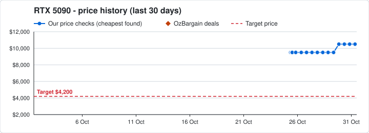

| | Price | Store | Product | Stock |
|---|---:|---|---|---|
| 🎮 | **$10,499** | PC Case Gear | 1. [ASUS GeForce RTX 5090 TUF Gaming GDDR7 32GB [TUF-RTX5090-32G-GAMING]](https://www.pccasegear.com/products/68108/asus-geforce-rtx-5090-tuf-gaming-gddr7-32gb) | ⚪ check site |
| 🎮 | **$10,499** | PC Case Gear | 2. [MSI GeForce RTX 5090 Ventus 3X OC GDDR7 32GB [G5090-32V3C]](https://www.pccasegear.com/products/68151/msi-geforce-rtx-5090-ventus-3x-oc-gddr7-32gb) | ⚪ check site |
| 🎮 | **$10,999** | PC Case Gear | 3. [ZOTAC Gaming GeForce RTX 5090 SOLID OC GDDR7 32GB [ZT-B50900J-10P]](https://www.pccasegear.com/products/68098/zotac-gaming-geforce-rtx-5090-solid-oc-gddr7-32gb)<br><sub>Also: [$11,999 Scorptec](https://www.scorptec.com.au/product/graphics-cards/nvidia/115884-zt-b50900j-10p)</sub> | ⚪ check site |
| 🎮 | **$10,999** | PC Case Gear | 4. [MSI GeForce RTX 5090 Gaming Trio OC GDDR7 32GB [G5090-32GTC]](https://www.pccasegear.com/products/68150/msi-geforce-rtx-5090-gaming-trio-oc-gddr7-32gb) | ⚪ check site |
| 🎮 | **$10,999** | PC Case Gear | 5. [ASUS GeForce RTX 5090 TUF Gaming OC GDDR7 32GB [TUF-RTX5090-O32G-GAMI…](https://www.pccasegear.com/products/68109/asus-geforce-rtx-5090-tuf-gaming-oc-gddr7-32gb) | ⚪ check site |

## Processors

### Ryzen 7 9800X3D
Target: **$549**

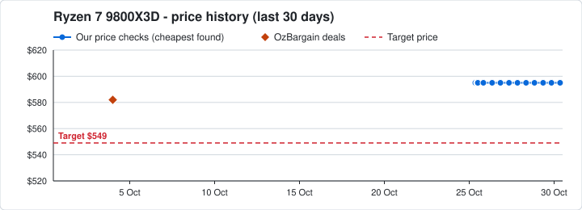

| | Price | Store | Product | Stock |
|---|---:|---|---|---|
|  | **$595** | CCPU Computers | 1. [AMD RYZEN 7 9800X3D CPU 100-100001084WOF](https://www.ccpu.com.au/product/amd-ryzen-7-9800x3d-cpu-100-100001084wof/) | ⚪ check site |
|  | **$599** | Scorptec | 2. [[100-100001084WOF] AMD Ryzen 7 9800X3D Desktop Processor](https://www.scorptec.com.au/product/cpu/amd-socket-am5/114321-100-100001084wof) | ⚪ check site |
|  | **$599** | PC Case Gear | 3. [AMD Ryzen 7 9800X3D Processor [100-100001084WOF] [Avail: In Stock]](https://www.pccasegear.com/products/67543/amd-ryzen-7-9800x3d-processor) | 🟢 in stock |
|  | **$599** | JW Computers | 4. [AMD Ryzen 7 9800X3D 8 Core 16 Threads AM5 Processor](https://www.jw.com.au/product/amd-ryzen-7-9800x3d-8-core-processor) | ⚪ check site |
|  | **$599** | UMart | 5. [100-100001084WOF AMD Ryzen 7 9800X3D 8 Core AM5 5.2GHz CPU Proces(In …](https://www.umart.com.au/product/amd-ryzen-7-9800x3d-8-core-am5-5-2ghz-cpu-processor-100-100001084wof-80125) | 🟢 in stock |

<details>
<summary>OzBargain deal history, last 12 months (13)</summary>

- 04 Oct · $581.99 · Amazon DE via AU · [AMD Ryzen 7 9800X3D 8-Core, 16-Thread Desktop Processor $581.99 (RRP $821) Delivered @ Amazon DE vi…](https://www.ozbargain.com.au/node/977686) (expired)
- 11 Sep · $555.60 · Mwave · [AMD Ryzen 7 9800X3D $555.60 Delivered @ Mwave](https://www.ozbargain.com.au/node/974670) (expired)
- 23 Aug · $569.54 · Amazon DE via AU · [AMD Ryzen 7 9800X3D 8-Core, 16-Thread Desktop Processor $569.54 Delivered @ Amazon DE via AU](https://www.ozbargain.com.au/node/972376) (expired)
- 17 Aug · $478.04 · AuroraSilicon Store AliExpress · [AMD Ryzen 7 9800X3D CPU US$337.02 (~A$478.04) with PayPal Delivered @ AuroraSilicon Store AliExpress](https://www.ozbargain.com.au/node/971685) (expired)
- 01 Jun · $503.28 · JS-Computer via AliExpress · [AMD R7 9800X3D 8-Core 16-Thread 5.2GHz CPU US$348.82 (~A$503.28) with PayPal Delivered @ JS-Compute…](https://www.ozbargain.com.au/node/961487) (expired)
- 20 May · $599 · Computer Alliance · [AMD AM5 Ryzen 7 9800X3D 8 Core 5.2GHz Tray CPU $599 + Shipping ($0 QLD C&C) @ Computer Alliance](https://www.ozbargain.com.au/node/960001) (expired)
- 22 Mar · $649 · Centre Com · [AMD Ryzen 7 9800X3D CPU $649 Delivered / C&C @ Centre Com](https://www.ozbargain.com.au/node/953023) (expired)
- 16 Mar · $510.53 · Yeah Magic Flagship Store AliExpress · [AMD Ryzen 7 9800X3D CPU US$357.37 (~A$510.53) AU Stock Delivered @ Yeah Magic Flagship Store AliExp…](https://www.ozbargain.com.au/node/952061) (expired)
- 09 Mar · $631.80 · Smart Home Store eBay · [AMD Ryzen 7 9800X3D CPU $631.80 Delivered @ Smart Home Store eBay](https://www.ozbargain.com.au/node/951043) (expired)
- 16 Feb · $581 · AuroraSilicon Store AliExpress · [AMD Ryzen 7 9800X3D CPU US$411.86 (~A$581) Delivered @ AuroraSilicon Store AliExpress](https://www.ozbargain.com.au/node/948398) (expired)
- 04 Feb · $661 · Centre Com · [AMD Ryzen 7 9800X3D CPU $661 Delivered ($0 C&C/ in-Store) @ Centre Com](https://www.ozbargain.com.au/node/946865) (expired)
- 19 Jan · $539.10 · Hub by Triforce · [[Box Damaged] AMD Ryzen 7 9800X3D Processor $539.10 Delivered @ Hub by Triforce](https://www.ozbargain.com.au/node/944835) (expired)
- 29 Nov · $589 · Binary Tech Store AliExpress · [AMD Ryzen 7 9800X3D CPU US$385.33 (~A$589) Delivered @ Binary Tech Store AliExpress](https://www.ozbargain.com.au/node/937413) (expired)

</details>

### Ryzen 7 9850X3D
Target: **$699**

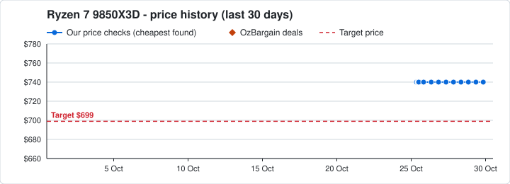

| | Price | Store | Product | Stock |
|---|---:|---|---|---|
|  | **$740** | CCPU Computers | 1. [AMD RYZEN 7 9850X3D CPU 100-100001973WOF](https://www.ccpu.com.au/product/amd-ryzen-7-9850x3d-cpu-100-100001973wof/) | ⚪ check site |
|  | **$742.77** | JW Computers | 2. [AMD Ryzen 7 9850X3D 8 Core Processor](https://www.jw.com.au/product/amd-ryzen-7-9850x3d-8-core-processor) | ⚪ check site |
|  | **$744** | UMart | 3. [100-100001973WOF AMD Ryzen 7 9850X3D 8 Core 5.6 GHz AM5 CPU Proce(In …](https://www.umart.com.au/product/amd-ryzen-7-9850x3d-8-core-5-6-ghz-am5-cpu-processor-100-100001973wof-92287) | 🟢 in stock |
|  | **$744** | MSY | 4. [100-100001973WOF AMD Ryzen 7 9850X3D 8 Core 5.6 GHz AM5 CPU Proce(In …](https://www.msy.com.au/product/amd-ryzen-7-9850x3d-8-core-5-6-ghz-am5-cpu-processor-100-100001973wof-92287) | 🟢 in stock |
|  | **$744** | Scorptec | 5. [[100-100001973WOF] AMD Ryzen 7 9850X3D Desktop Processor](https://www.scorptec.com.au/product/cpu/amd-socket-am5/123647-100-100001973wof) | ⚪ check site |

### Ryzen 9 9950X3D
Target: **$899**

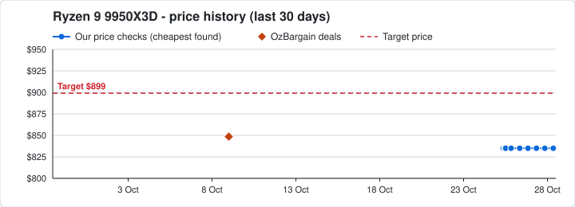

| | Price | Store | Product | Stock |
|---|---:|---|---|---|
|  | **$835** ✅ | CCPU Computers | 1. [AMD RYZEN 9 9950X3D OEM CPU on tray 100-100000719WOF 3 years wty](https://www.ccpu.com.au/product/amd-ryzen-9-9950x3d-oem-cpu-on-tray-100-100000719wof-3-years-wty/) | ⚪ check site |
|  | **$920** | CCPU Computers | 2. [AMD RYZEN 9 9950X3D CPU 100-100000719WOF](https://www.ccpu.com.au/product/amd-ryzen-9-9950x3d-cpu-100-100000719wof/) | ⚪ check site |
|  | **$939** | UMart | 3. [100-100000719WOF AMD Ryzen 9 9950X3D 16 Core AM5 5.7GHz CPU Proce(In …](https://www.umart.com.au/product/amd-ryzen-9-9950x3d-16-core-am5-5-7ghz-cpu-processor-100-100000719wof-81996) | 🟢 in stock |
|  | **$939** | Scorptec | 4. [[100-100000719WOF] AMD Ryzen 9 9950X3D Desktop Processor](https://www.scorptec.com.au/product/cpu/amd-socket-am5/116832-100-100000719wof) | ⚪ check site |
|  | **$939** | PC Case Gear | 5. [AMD Ryzen 9 9950X3D Processor [100-100000719WOF] [Avail: In Stock]](https://www.pccasegear.com/products/68688/amd-ryzen-9-9950x3d-processor) | 🟢 in stock |

<details>
<summary>OzBargain deal history, last 12 months (4)</summary>

- 09 Oct · $848.50 · Amazon UK via AU · [AMD Ryzen 9 9950X3D CPU $848.50 Delivered @ Amazon UK via AU](https://www.ozbargain.com.au/node/978308) (expired)
- 15 Feb · $959 · Computer Alliance · [AMD Ryzen 9 9950X3D CPU $959 + Delivery ($0 QLD C&C, Redeem Crimson Desert via AMD) @ Computer Alli…](https://www.ozbargain.com.au/node/948287) (expired)
- 03 Feb · $960 · Centre Com · [AMD Ryzen 9 9950X3D CPU $960 Delivered ($0 C&C/ in-Store) @ Centre Com](https://www.ozbargain.com.au/node/946582) (expired)
- 21 Nov · $859.51 · Binary Tech Store Aliexpress · [AMD Ryzen 9 9950X3D US$554.30 (~A$859.51) Delivered @ Binary Tech Store Aliexpress](https://www.ozbargain.com.au/node/935112) (expired)

</details>

## Memory (RAM)

### DDR5 32GB (2x16GB) 6000MHz CL30
Target: **$349**

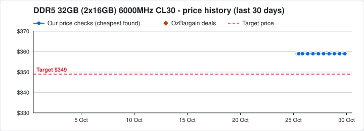

| | Price | Store | Product | Stock |
|---|---:|---|---|---|
| 💾 | **$359** | Computer & Parts Land | 1. [Team CTCED532G6000HC30DC01 T-CREATE EXPERT DDR5 32GB (16GBx2) 6000MHz…](https://cplonline.com.au/team-ctced532g6000hc30dc01-t-create-expert-ddr5-32gb-16gbx2-6000mhz-cl30-memory.html) | ⚪ check site |
|  | **$689** | MSY | 2. [CMK32GX5M2B6000C30 Corsair Vengeance 32GB (2x16GB) 6000MHz CL30 DDR5 …](https://www.msy.com.au/product/corsair-vengeance-32gb-2x16gb-6000mhz-cl30-ddr5-ram-cmk32gx5m2b6000c30-71933)<br><sub>Also: [$689 UMart](https://www.umart.com.au/product/corsair-vengeance-32gb-2x16gb-6000mhz-cl30-ddr5-ram-cmk32gx5m2b6000c30-71933) · [$799 Computer & Parts Land](https://cplonline.com.au/team-ff3d532g6000hc30dc01-t-force-delta-rgb-32gb-2x16gb-6000mhz-cl30-ddr5-xmp-3-0-memory.html) · [$839 JW Computers](https://www.jw.com.au/product/klevv-cras-v-rgb-32gb-2x16gb-ddr5-6000-cl30-bk) · [$849 PC Case Gear](https://www.pccasegear.com/products/70055/team-t-create-expert-32gb-2x16gb-6000mhz-cl30-ddr5-black)</sub> | ⚪ check site |
|  | **$749** | Mwave | 3. [KLEVV CRAS V RGB 32GB (2x 16GB) DDR5 6000MHz CL30 Intel XMP & AMD EXP…](https://www.mwave.com.au/products/klevv-cras-v-rgb-32gb-2x-16gb-ddr5-6000mhz-cl30-intel-xmp-amd-expo-desktop-memory-black-ac78805) | 🟢 in stock |
|  | **$749** | Mwave | 4. [KLEVV CRAS V RGB 32GB (2x 16GB) DDR5 6000MHz CL30 Intel XMP & AMD EXP…](https://www.mwave.com.au/products/klevv-cras-v-rgb-32gb-2x-16gb-ddr5-6000mhz-cl30-intel-xmp-amd-expo-desktop-memory-white-ac78809) | 🟢 in stock |
|  | **$799** | PC Case Gear | 5. [Klevv Fit V 32GB (2x16GB) 6000MHz CL30 DDR5 White [KD5AGU880-60A300F]…](https://www.pccasegear.com/products/72155/klevv-fit-v-32gb-2x16gb-6000mhz-cl30-ddr5-white) | 🟢 in stock |

<details>
<summary>OzBargain deal history, last 12 months (6)</summary>

- 21 Apr · $422 · Amazon AU · [Corsair Vengeance DDR5 RAM 32GB (2x16GB) 6000MHz CL30 Intel XMP iCUE Compatible $422 Delivered @ Am…](https://www.ozbargain.com.au/node/956395) (expired)
- 05 Mar · $799 · PC Case Gear · [Corsair Dominator Titanium 64GB (2x32GB) 6000MHz CL30 DDR5 RAM (Grey) $799 Delivered / VIC C&C @ PC…](https://www.ozbargain.com.au/node/950602) (expired)
- 24 Feb · $499 · Mwave · [PNY XLR8 Gaming 32GB (2x 16GB) DDR5 6000MT/s CL30 RGB RAM $499 + Delivery ($0 NSW C&C/ mVIP) @ Mwave](https://www.ozbargain.com.au/node/949314) (expired)
- 23 Dec · $479.99 · TEAMGROUP via Amazon AU · [TEAMGROUP T-Force Delta RGB DDR5 Ram 32GB (2x16GB) 6000MHz CL30 $479.99 Delivered @ TEAMGROUP via A…](https://www.ozbargain.com.au/node/941384) (expired)
- 18 Dec · $324 · Amazon AU · [[Back Order] Kingston Fury Beast DDR5 6000MT/s 32GB (2x16GB) CL30 RAM $324 Delivered @ Amazon AU](https://www.ozbargain.com.au/node/940606) (expired)
- 19 Nov · $420.19 · Amazon UK via AU · [Corsair Vengeance DDR5 64GB (2x32GB) 6000MHz CL30 - $420.19 Delivered @ Amazon UK via AU](https://www.ozbargain.com.au/node/934394) (expired)

</details>

### DDR5 64GB (2x32GB) 6000MHz CL30
Target: **$899**

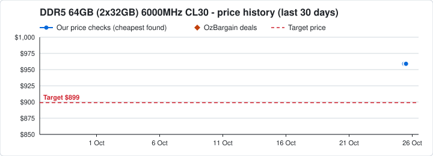

| | Price | Store | Product | Stock |
|---|---:|---|---|---|
| 💾 | **$959** | Computer & Parts Land | 1. [G.Skill F5-6000J3040G32GX2-RS5K Ripjaws S5 64GB (2x 32GB) DDR5 6000MH…](https://cplonline.com.au/g-skill-f5-6000j3040g32gx2-rs5k-ripjaws-s5-64gb-2x-32gb-ddr5-6000mhz-cl30-desktop-memory-black.html) | ⚪ check site |
|  | **$1,499** | Mwave | 2. [KLEVV CRAS V RGB 64GB (2x 32GB) DDR5 6000MHz CL30 Desktop Memory - Wh…](https://www.mwave.com.au/products/klevv-cras-v-rgb-64gb-2x-32gb-ddr5-6000mhz-cl30-desktop-memory-white-ac78811) | 🟢 in stock |
|  | **$1,599** | Mwave | 3. [KLEVV CRAS V RGB 64GB (2x 32GB) DDR5 6000MHz CL30 Desktop Memory - Bl…](https://www.mwave.com.au/products/klevv-cras-v-rgb-64gb-2x-32gb-ddr5-6000mhz-cl30-desktop-memory-black-ac78807) | 🟢 in stock |
| 💾 | **$1,799** | Scorptec | 4. [[SP064GXLWU60AFDF] Silicon Power XPOWER Zenith RGB 64GB (2x32GB) 6000…](https://www.scorptec.com.au/product/memory/ddr5-desktop-memory/129715-sp064gxlwu60afdf) | ⚪ check site |
| 💾 | **$1,899** | PC Case Gear | 5. [Klevv Cras V RGB 64GB (2x32GB) 6000MHz CL30 DDR5 Black [KD5BGUA80-60A…](https://www.pccasegear.com/products/71063/klevv-cras-v-rgb-64gb-2x32gb-6000mhz-cl30-ddr5-black) | 🟢 in stock |

<details>
<summary>OzBargain deal history, last 12 months (2)</summary>

- 05 Mar · $799 · PC Case Gear · [Corsair Dominator Titanium 64GB (2x32GB) 6000MHz CL30 DDR5 RAM (Grey) $799 Delivered / VIC C&C @ PC…](https://www.ozbargain.com.au/node/950602) (expired)
- 19 Nov · $420.19 · Amazon UK via AU · [Corsair Vengeance DDR5 64GB (2x32GB) 6000MHz CL30 - $420.19 Delivered @ Amazon UK via AU](https://www.ozbargain.com.au/node/934394) (expired)

</details>

## Storage (SSD)

### 2TB NVMe SSD
Target: **$219**

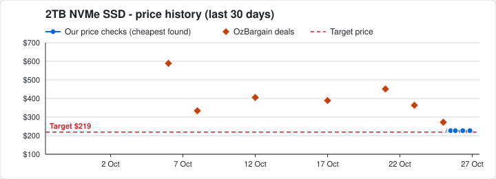

| | Price | Store | Product | Stock |
|---|---:|---|---|---|
| 🗄️ | **$226.70** | Computer & Parts Land | 1. [MSI SPATIUM M470 PRO 2TB PCIe 4.0 NVMe M.2 2280 SSD](https://cplonline.com.au/msi-spatium-m470-pro-2tb-pcie-4-0-nvme-m-2-2280-ssd.html) | ⚪ check site |
| 🗄️ | **$259** | Computer & Parts Land | 2. [HP 8U2N5AA# FX700 2TB PCIe Gen 4x4 NVMe M.2 2280 SSD](https://cplonline.com.au/hp-8u2n5aa-fx700-2tb-pcie-gen-4x4-nvme-m-2-2280-ssd.html) | ⚪ check site |
|  | **$329** | MSY | 3. [AG4732TB Gigabyte 2TB Aorus PCIe 4.0 NVMe M.2 2280 SSD with Heatsink](https://www.msy.com.au/product/gigabyte-2tb-ag4732tb-aorus-pcie-4-0-nvme-m-2-2280-ssd-with-heatsink-84128)<br><sub>Also: [$329 UMart](https://www.umart.com.au/product/gigabyte-2tb-ag4732tb-aorus-pcie-4-0-nvme-m-2-2280-ssd-with-heatsink-84128)</sub> | ⚪ check site |
|  | **$329** | UMart | 4. [TS2TMTE260S Transcend 2TB NVMe PCIe Gen5 M.2 2280 SSD](https://www.umart.com.au/product/transcend-2tb-ts2tmte260s-nvme-pcie-gen5-m-2-2280-ssd-85961)<br><sub>Also: [$329 MSY](https://www.msy.com.au/product/transcend-2tb-ts2tmte260s-nvme-pcie-gen5-m-2-2280-ssd-85961)</sub> | ⚪ check site |
| 🗄️ | **$339** | Computer & Parts Land | 5. [Crucial CT2000P3PSSD8 P3 Plus 2TB M.2 Internal NVMe PCIE4 SSD](https://cplonline.com.au/crucial-ct2000p3pssd8-p3-plus-2tb-m-2-internal-nvme-pcie4-ssd.html) | ⚪ check site |

**🔥 OzBargain deals (last 30 days):**

- 23 Oct · 👍 55 · [Crucial P310 2280 PCIe Gen4 3D NAND NVMe M.2 Internal SSD 2TB $363.18 Delivered @ Amazon UK via AU](https://www.ozbargain.com.au/node/980031)

<details>
<summary>OzBargain deal history, last 12 months (34)</summary>

- 25 Oct · $272.29 · Amazon Germany via AU · [Western Digital WD Black SN850P NVMe M.2 2TB SSD for PS5 $272.29 Delivered @ Amazon Germany via AU](https://www.ozbargain.com.au/node/980297) (expired)
- 23 Oct · $363.18 · Amazon UK via AU · [Crucial P310 2280 PCIe Gen4 3D NAND NVMe M.2 Internal SSD 2TB $363.18 Delivered @ Amazon UK via AU](https://www.ozbargain.com.au/node/980031)
- 21 Oct · $451.25 · Mwave · [[Back Order] Lexar NM990 2TB PCIe 5.0 NVMe M.2 SSD $451.25 + Free Shipping @ Mwave](https://www.ozbargain.com.au/node/979814) (expired)
- 17 Oct · $389 · MSY · [PNY CS2241 2TB PCIe Gen4 M.2 NVMe SSD $389 + Shipping ($0 C&C) @ MSY](https://www.ozbargain.com.au/node/979321) (expired)
- 12 Oct · $405.02 · Amazon UK via AU · [Corsair MP700 PRO with Air Cooler 2TB M.2 PCIe Gen5 x4 NVMe 2.0 SSD $405.02 Delivered @ Amazon UK v…](https://www.ozbargain.com.au/node/978619) (expired)
- 08 Oct · $333.67 · Amazon AU · [WD_BLACK SN850P 2TB NVMe M.2 SSD for PS5 (with Heatsink) $333.67 Delivered @ Amazon AU](https://www.ozbargain.com.au/node/978162) (expired)
- 06 Oct · $589 · Computer Alliance · [Samsung 990 EVO Plus 2TB M.2 NVMe Gen4 SSD $589 + Delivery ($0 QLD C&C) @ Computer Alliance](https://www.ozbargain.com.au/node/977841)
- 25 Sep · $231.95 · Mwave · [Silicon Power XS70 2TB PCIe Gen 4 NVMe M.2 SSD $231.95 + Delivery @ Mwave](https://www.ozbargain.com.au/node/976405) (expired)
- 25 Sep · $159 · Mwave · [Kingston NV2 2TB NVMe M.2 2280 SSD $159.00 + Delivery @ Mwave](https://www.ozbargain.com.au/node/976408) (expired)
- 03 Sep · $429.71 · Amazon UK via AU · [Corsair MP600 PRO LPX 2TB M.2 NVMe PCIe X4 Gen4 SSD $429.71 (RRP $908) Delivered @ Amazon UK via AU](https://www.ozbargain.com.au/node/973729) (expired)
- 24 Aug · $336.79 · Amazon UK via AU · [Crucial P310 2TB 2280 PCIe Gen4 3D Nand NVMe M.2 Internal SSD $336.79 Delivered @ Amazon UK via AU](https://www.ozbargain.com.au/node/972488) (expired)
- 18 Aug · $327.26 · Amazon US via AU · [Crucial T500 2TB PCIe Gen4 NVMe M.2 SSD $327.26 Delivered @ Amazon US via AU](https://www.ozbargain.com.au/node/971819) (expired)
- 17 Aug · $340.50 · Amazon DE via AU · [Crucial P310 2TB 2280 PCIe Gen4 3D NAND NVMe M.2 Internal SSD $340.50 Delivered @ Amazon DE via AU](https://www.ozbargain.com.au/node/971698) (expired)
- 13 Aug · $524.80 · Amazon UK via AU · [Samsung 990 PRO 2TB PCIe 4.0 NVMe M.2 SSD $524.80 Delivered @ Amazon UK via AU](https://www.ozbargain.com.au/node/971250) (expired)
- 24 Jun · $228.23 · Amazon Germany via AU · [Western Digital 2TB WD Blue SN5000 NVMe $228.23 (RRP $385.25) Delivered @ Amazon Germany via AU](https://www.ozbargain.com.au/node/964922) (expired)
- 02 Jun · $224.56 · Amazon Germany via AU · [Western Digital 2TB WD Blue SN5000 M.2 NVMe SSD $224.56 Delivered @ Amazon Germany via AU](https://www.ozbargain.com.au/node/961719) (expired)
- 15 May · $303.55 · Amazon US via AU · [2TB Samsung 970 Evo PLUS NVMe M.2 PCIe SSD MZ-V7S2T0BW $303.55 Delivered @ Amazon US via AU](https://www.ozbargain.com.au/node/959407) (expired)
- 30 Apr · $224.25 · Amazon Germany via AU · [Western Digital 2TB WD Blue SN5000 M.2 NVMe SSD $224.25 Delivered @ Amazon Germany via AU](https://www.ozbargain.com.au/node/957440) (expired)
- 24 Apr · $264.31 · Amazon German via AU · [Samsung 990 PRO 2TB NVMe M.2 SSD $264.31 Delivered @ Amazon German via AU](https://www.ozbargain.com.au/node/956755) (expired)
- 22 Apr · $290 · Amazon AU · [Corsair MP600 PRO LPX 2TB NVMe PCIe X4 Gen4 M.2 (2280) SSD with Heatsink $290 Delivered @ Amazon AU](https://www.ozbargain.com.au/node/956419) (expired)
- 21 Feb · $311 · Centre Com · [[Pre Order] Crucial P510 2TB PCIe Gen5 NVMe 2280 M.2 SSD with Heatsink $311 Delivered @ Centre Com](https://www.ozbargain.com.au/node/949017) (expired)
- 09 Feb · $310.51 · Amazon Germany via AU · [Samsung 990 PRO with Heatsink 2TB PCIe 4.0 NVMe M.2 SSD $310.51 Delivered @ Amazon Germany via AU](https://www.ozbargain.com.au/node/947466) (expired)
- 28 Jan · $159 · PLE · [Silicon Power UD90 2TB PCIe Gen4 NVMe M.2 SSD $159 + Delivery ($0 WA C&C) @ PLE](https://www.ozbargain.com.au/node/945869) (expired)
- 22 Jan · $167.99 · Fanxiang-Official-Store eBay · [Fanxiang S770/S880 NVMe SSD: 1TB $167.99, 2TB $271.99, 4TB $423.99 Delivered @ Fanxiang-Official-St…](https://www.ozbargain.com.au/node/945116) (expired)
- 07 Jan · $300.85 · Amazon UK via AU · [Samsung 990 PRO 2TB PCIe 4.0 NVMe M.2 SSD $300.85 Delivered @ Amazon UK via AU](https://www.ozbargain.com.au/node/943412) (expired)
- 05 Jan · $284.34 · Amazon US via AU · [WD_BLACK SN7100 2TB PCIe Gen4 NVMe M.2 SSD $284.34 Delivered @ Amazon US via AU](https://www.ozbargain.com.au/node/943229) (expired)
- 26 Dec · $259.18 · Amazon US va AU · [Crucial P510 2TB PCIe Gen5 NVMe 2280 M.2 SSD $259.18 Delivered @ Amazon US va AU](https://www.ozbargain.com.au/node/941883) (expired)
- 26 Dec · $372.32 · Amazon UK via AU · [2TB Samsung 9100 PRO M.2 NVMe PCIe 5.0 SSD $372.32 Delivered @ Amazon UK via AU](https://www.ozbargain.com.au/node/941929) (expired)
- 26 Dec · $226.85 · Amazon US va AU · [Crucial P310 2TB 2280 PCIe Gen4 NVMe M.2 SSD $226.85 Delivered @ Amazon US va AU](https://www.ozbargain.com.au/node/941951) (expired)
- 25 Dec · $268.70 · Amazon.com.au · [Crucial T700 2TB PCIe Gen 5 NVMe SSD with Heataink $268.70 Delivered @ Amazon.com.au](https://www.ozbargain.com.au/node/941715) (expired)
- 08 Dec · $263.26 · Amazon UK via AU · [Crucial T500 2TB PCIe Gen4 NVMe M.2 SSD $263.26 Delivered @ Amazon UK via AU](https://www.ozbargain.com.au/node/938914) (expired)
- 24 Nov · $162.23 · Fanxiang via eBay · [Fanxiang S880 M.2 2TB PS5 SSD NVMe SSD 4.0 PCIe Internal SSD ($162.23 eBay Plus) Delivered @ Fanxia…](https://www.ozbargain.com.au/node/935770) (expired)
- 19 Nov · $225.64 · Amazon UK via AU · [Samsung 990 PRO 2TB PCIe 4.0 NVMe M.2 SSD $225.64 Delivered @ Amazon UK via AU](https://www.ozbargain.com.au/node/934499) (expired)
- 19 Nov · $193.53 · Amazon UK via AU · [Samsung 990 EVO Plus 2TB M.2 NVMe SSD $193.53 Delivered @ Amazon UK via AU](https://www.ozbargain.com.au/node/934512) (expired)

</details>

### 4TB NVMe SSD
Target: **$429**

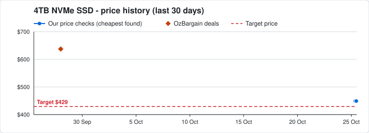

| | Price | Store | Product | Stock |
|---|---:|---|---|---|
| 🗄️ | **$449** | Computer & Parts Land | 1. [HP 8U2N7AA# FX700 4TB PCIe Gen 4x4 NVMe M.2 2280 SSD](https://cplonline.com.au/hp-8u2n7aa-fx700-4tb-pcie-gen-4x4-nvme-m-2-2280-ssd.html) | ⚪ check site |
|  | **$549** | MSY | 2. [K04TBM2SP0-C91 KLEVV 4TB CRAS C910 PCIe 4.0 NVMe M.2 2280 SSD(In Stoc…](https://www.msy.com.au/product/klevv-4tb-cras-c910-k04tbm2sp0-c91-pcie-4-0-nvme-m-2-2280-ssd-80369)<br><sub>Also: [$549 UMart](https://www.umart.com.au/product/klevv-4tb-cras-c910-k04tbm2sp0-c91-pcie-4-0-nvme-m-2-2280-ssd-80369)</sub> | 🟢 in stock |
|  | **$549** | MSY | 3. [SFYRD/4000g Kingston FURY Renegade 4TB PCIe Gen4 M.2 2280 NVMe SSD](https://www.msy.com.au/product/kingston-fury-renegade-4tb-pcie-gen4-m-2-2280-nvme-ssd-sfyrd-4000g-61471)<br><sub>Also: [$549 UMart](https://www.umart.com.au/product/kingston-fury-renegade-4tb-pcie-gen4-m-2-2280-nvme-ssd-sfyrd-4000g-61471)</sub> | ⚪ check site |
| 🗄️ | **$599** | Computer & Parts Land | 4. [MSI SPATIUM M461 4TB PCIe 4.0 NVMe M.2 SSD](https://cplonline.com.au/msi-spatium-m461-4tb-pcie-4-0-nvme-m-2-ssd.html) | ⚪ check site |
|  | **$699** | MSY | 5. [K04TBM2SP0-10G KLEVV 4TB CRAS C910G PCIe 4.0 NVMe M.2 2280 SSD(In Sto…](https://www.msy.com.au/product/klevv-4tb-k04tbm2sp0-10g-cras-c910g-pcie-4-0-nvme-m-2-2280-ssd-94494)<br><sub>Also: [$699 UMart](https://www.umart.com.au/product/klevv-4tb-k04tbm2sp0-10g-cras-c910g-pcie-4-0-nvme-m-2-2280-ssd-94494)</sub> | 🟢 in stock |

**🔥 OzBargain deals (last 30 days):**

- 30 Oct · 👍 1 · [Klevv 4TB Cras C910G PCIe 4.0 NVMe M.2 2280 SSD $699, $711 Delivered @MSY](https://www.ozbargain.com.au/node/980907)

<details>
<summary>OzBargain deal history, last 12 months (17)</summary>

- 30 Oct · $699 · MSY · [Klevv 4TB Cras C910G PCIe 4.0 NVMe M.2 2280 SSD $699, $711 Delivered @MSY](https://www.ozbargain.com.au/node/980907)
- 28 Sep · $637.43 · Amazon UK via AU · [Corsair MP600 PRO LPX 4TB M.2 NVMe PCIe X4 Gen4 SSD $637.43 Delivered @ Amazon UK via AU](https://www.ozbargain.com.au/node/976703) (expired)
- 07 Sep · $629 · Tech Junction via Kogan · [WD Blue SN5000 4TB PCIe Gen4 M.2 2280 NVMe SSD $629 Delivered @ Tech Junction via Kogan](https://www.ozbargain.com.au/node/974154) (expired)
- 02 Sep · $618.30 · Mwave · [KLEVV CRAS C910G 4TB PCIe 4.0 NVMe M.2 2280 SSD $618.30 Delivered @ Mwave](https://www.ozbargain.com.au/node/973693) (expired)
- 16 Aug · $852.68 · Amazon UK via AU · [Crucial T710 SSD 4TB M.2 NVMe PCIe 5.0 x4 Gen5 $852.68 Delivered @ Amazon UK via AU](https://www.ozbargain.com.au/node/971515) (expired)
- 02 Mar · $575.98 · Amazon UK via AU · [[Prime] Crucial T705 4TB M.2 NVMe SSD with Heatsink $575.98 Delivered @ Amazon UK via AU](https://www.ozbargain.com.au/node/950129) (expired)
- 28 Feb · $399 · PC Case Gear · [Team T-Force Z44A7 M.2 PCIe Gen4 NVMe SSD 4TB $399 + Delivery ($0 VIC C&C) @ PC Case Gear](https://www.ozbargain.com.au/node/949850) (expired)
- 14 Feb · $420.27 · Amazon US via AU · [Crucial P3 Plus 4TB PCIe Gen4 3D NAND NVMe M.2 SSD $420.27 Shipped @ Amazon US via AU](https://www.ozbargain.com.au/node/948270) (expired)
- 11 Feb · $388 · Centre Com · [Biwin M350 4TB PCIe Gen4 NVMe M.2 SSD $388 Delivered ($0 VIC, NSW, SA, QLD C&C/ in-Store) @ Centre …](https://www.ozbargain.com.au/node/947859) (expired)
- 18 Jan · $554.99 · Amazon AU · [Lexar NM790 4TB M.2 2280 PCIe Gen4x4 NVMe 1.4 SSD $554.99 Delivered @ Amazon AU](https://www.ozbargain.com.au/node/944680) (expired)
- 30 Dec · $540.66 · Amazon US via AU · [Crucial T705 4TB Gen5 NVMe SSD $540.66 Delivered @ Amazon US via AU](https://www.ozbargain.com.au/node/942467) (expired)
- 21 Dec · $368 · EB Games eBay · [[eBay Plus] Atrix 4TB PCIe Gen4x4 M.2 NVMe SSD with Heatsink (PlayStation 5 Compatible) $368 Delive…](https://www.ozbargain.com.au/node/941204) (expired)
- 30 Nov · $376.09 · Amazon UK via AU · [Crucial P3 4TB NVMe M.2 2280 SSD Acronis Edition $376.09 ($357.29 with Prime) Delivered @ Amazon UK…](https://www.ozbargain.com.au/node/937617) (expired)
- 24 Nov · $429 · Mwave · [Lexar NM790 4TB PCIe 4.0 NVMe M.2 SSD $429 + Delivery ($0 to Metro/ mVIP/ NSW C&C) @ Mwave](https://www.ozbargain.com.au/node/935715) (expired)
- 24 Nov · $311.92 · Fanxiang eBay · [Fanxiang S880 4TB M.2 NVMe SSD Gaming PCIe 4.0 $311.92 ($304.19 eBay Plus) Delivered @ Fanxiang eBay](https://www.ozbargain.com.au/node/935778) (expired)
- 21 Nov · $399 · LingsTech · [Lexar Ares M.2 2280 PCIe Gen 4×4 NVMe 4TB TLC SSD $399 + Shipped @ LingsTech](https://www.ozbargain.com.au/node/935103) (expired)
- 19 Nov · $575.51 · Amazon UK via AU · [Samsung 9100 PRO 4TB M.2 NVMe SSD $575.51 Delivered @ Amazon UK via AU](https://www.ozbargain.com.au/node/934516) (expired)

</details>

### 8TB NVMe SSD
Target: **$1,199**

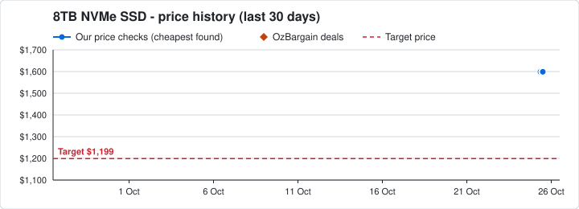

| | Price | Store | Product | Stock |
|---|---:|---|---|---|
|  | **$1,599** | Scorptec | 1. [[BX570DN08TB-RGX] Biwin Black Opal X570 PRO 8TB M.2 2280 NVMe 2.0 PCI…](https://www.scorptec.com.au/product/hard-drives-and-ssds/solid-state-drives--ssd/126550-bx570dn08tb-rgx) | ⚪ check site |
| 🗄️ | **$1,799** | Scorptec | 2. [[AGAMMIXS70B-8T-CS] XPG GAMMIX S70 Blade 8TB M.2 2280 NVMe PCIe Gen4 …](https://www.scorptec.com.au/product/hard-drives-and-ssds/solid-state-drives--ssd/108640-agammixs70b-8t-cs) | ⚪ check site |
| 🗄️ | **$1,999** | JW Computers | 3. [Lexar 8TB NM790 M.2 2280 PCIe Gen4x4 NVMe SSD](https://www.jw.com.au/product/lexar-8tb-nm790-m-2-2280-pcie-gen4x4-nvme-ssd) | ⚪ check site |
| 🗄️ | **$1,999** | JW Computers | 4. [PNY CS3140 8TB M.2 NVMe Gen4 SSD](https://www.jw.com.au/product/pny-cs3140-8tb-m-2-nvme-gen4-ssd) | ⚪ check site |
|  | **$1,999** | Scorptec | 5. [[LNM790X008T-RNNNG] Lexar NM790 8TB M.2 2280 NVMe PCIe 4.0 SSD](https://www.scorptec.com.au/product/hard-drives-and-ssds/solid-state-drives--ssd/115341-lnm790x008t-rnnng)<br><sub>Also: [$2,250 Mwave](https://www.mwave.com.au/products/lexar-nm790-8tb-pcie-40-nvme-m2-ssd-lnm790x008trnnng-ac80859) · [$2,399 PLE Computers](https://www.ple.com.au/products/673519/lexar-nm790-pcie-gen4-nvme-m2-ssd-8tb) · [$2,664 I-Tech](http://www.clixGalore.com/PSale.aspx?BID=14785&AfID=100703&AdID=1632&AffDirectURL=https://www.i-tech.com.au/lnm790x008t-rnnng-lexar-lnm790x008t-rnnng-internal-ssd-8-424782.html) · [$2,699 PC Case Gear](https://www.pccasegear.com/products/67762/lexar-nm790-nvme-pcie-gen4-ssd-8tb)</sub> | ⚪ check site |

<details>
<summary>OzBargain deal history, last 12 months (1)</summary>

- 10 Jan · $980 · Amazon DE · [Lexar NM800 PRO 8TB M.2 2280 PCIe Gen4x4 NVMe SSD with Heatsink, 8TB €541.67 (~$980 AUD) Shipped @ …](https://www.ozbargain.com.au/node/943836) (expired)

</details>
<!-- PRICES:END -->

## How it works

1. **`parts.json`** lists each part: what to search, words that must (or must
   not) appear in the product name, and my target price.
2. **`sources.py`** has one function per website. Each one returns listings in
   the same shape (price, title, store, link, stock, picture).
3. **`price_watch.py`** collects listings from every website, filters out the
   wrong products (water blocks, laptops, prebuilt PCs...), sorts them cheapest
   first, finds pictures, and rewrites this page. It also adds the cheapest
   price for each part to **`price_history.csv`**.
4. **`history.py`** keeps the price history. It saves real, dated OzBargain deals
   (including expired ones, from the last ~45 days) into **`deal_history.csv`**
   and draws a 30-day price graph for every part into **`charts/`** (plain SVG
   files written by Python). Every dot is a real price with a real date - nothing
   is estimated or filled in, so a part with few data points just shows few dots.
5. **`.github/workflows/price-watch.yml`** tells GitHub to run it twice a day and
   save the new files back to the repo.

## Run it yourself

You only need Python 3 (no extra packages):

```bash
python price_watch.py
```

## Change what it watches

Edit `parts.json` - add a part, change a target price, or add words to
`exclude` if the wrong product keeps showing up.

## What I learned building this

- Downloading web pages and JSON with `urllib`
- Pulling data out of HTML and RSS feeds with regular expressions
- Splitting a program into modules (`sources.py`)
- Reading/writing JSON and CSV files
- Scheduling code with GitHub Actions (cron)
- Drawing graphs by writing SVG (text) files from Python, with no libraries
- Keeping a history file that can be re-run safely without adding duplicates

_Prices are for my own tracking only and may be out of date - always check the
store's site before buying._
